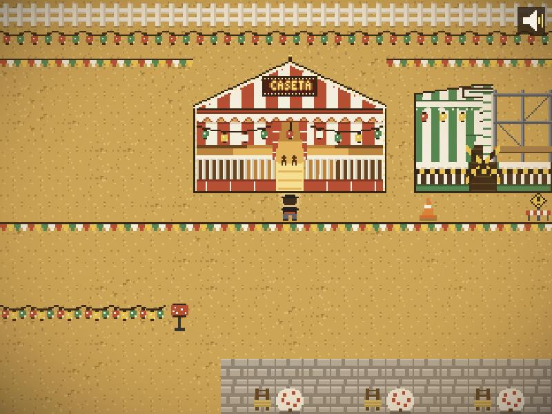

# Feria Portfolio

My developer portfolio, built as a small explorable game set in a Seville feria. You walk down the albero
street, and each caseta (the striped party tents of the Feria de Abril) is one of my projects. Walk up
to a door and press a button to step inside, read a project card or check out a caseta that's still
being built.



- **Caseta-musica** (the red-and-white caseta): inside, the jukebox shows the project card.
- **About me** (the whitewashed house): the bookshelf lists skills and the desk has my story.
- **Contact** (the yellow post box by the gate): links to reach me.
- **Green casetas behind caution tape**: projects in progress. They work as a visible roadmap and unlock
  when each project ships.

## Controls

| Action | Keyboard | Phone / tablet |
| --- | --- | --- |
| Walk | Arrow keys or WASD | Drag the virtual stick (bottom left) |
| Talk, read, enter, next page | Z or Enter | A button |
| Mute / unmute | M | Speaker button (top right) |

Sound starts after your first key press or tap, because browsers block autoplay.

## Stack, and why

- **Phaser 3 + TypeScript**: a mature 2D engine with tilemaps, tweens, input and Web Audio, plus types to
  keep the scene code honest.
- **Vite**: instant dev server and a static production build. No backend at all.
- **Tiled JSON maps**: the maps use Tiled's format, so they can be opened and edited in the Tiled editor
  and Phaser loads them directly.
- **Vitest**: the game rules that don't need a canvas are pure modules with unit tests: grid movement
  and collisions, dialogue paging, interaction lookup, the audio gate, the touch-stick deadzone, and a
  content consistency check (every building in the map has an entry in `projects.ts`).
- **GitHub Actions + GitHub Pages**: every push to `main` runs the tests, builds and deploys.

**Key design rule:** the map says *where* things are, and `src/content/projects.ts` says *what* they are.
A building in the map only carries an `id`, so adding or unlocking a project needs no engine changes.

## Add a project

1. **Place a building.** The overworld is generated by `tools/gen-maps.mjs` (it writes
   `public/assets/maps/feria.json`). In `buildFeria()`, place a caseta piece and a building object on its
   door tile, for example `m.piece(CPIECES.casetaObras, x, 3)` and
   `m.object('building', x + 2, 6, { id: 'my-project' })`, then run `node tools/gen-maps.mjs`.
   You can also open `feria.json` in Tiled and add an object of type `building` with a string property
   `id`, but re-running the generator overwrites hand edits.
2. **Describe it.** Add one entry with the same `id` to `src/content/projects.ts` (title, summary, tech,
   links). Set `locked: true` with a `teaser` while it's in progress. Flip it to `false` to open it.
3. **Optionally give it a room.** Set `interior` to a key of `src/content/interiors.ts` (or add a new room
   map there and in the generator). With `interior: null`, interacting shows the project card in place.
4. Run `npm test`. A map id with no project, or a project with no building, fails the build. In the game,
   an unknown id shows a visible warning instead of a dead door.

## Run locally

Requires Node 22.

```sh
npm install
npm run dev      # http://localhost:5173
npm test         # unit tests + map/content checks
npm run build    # static site in dist/
```

To check a build served from a sub-path, the way GitHub Pages serves it:

```sh
VITE_BASE=/feria-portfolio/ npm run build
npx vite preview # http://localhost:4173/feria-portfolio/
```

## Regenerate the assets

All art, maps and sound are original and generated in code with no dependencies beyond Node itself:

```sh
node tools/gen-assets.mjs   # tilesets, sprites, vignette (PNG)
node tools/gen-maps.mjs     # overworld and interior maps (Tiled JSON)
node tools/gen-audio.mjs    # ambient guitar loop and sound effects (WAV)
```

The scripts are deterministic, so running them again gives identical files.

## Credits

Every asset is original. See [CREDITS.md](CREDITS.md) (also readable on the Credits sign by the gate).
